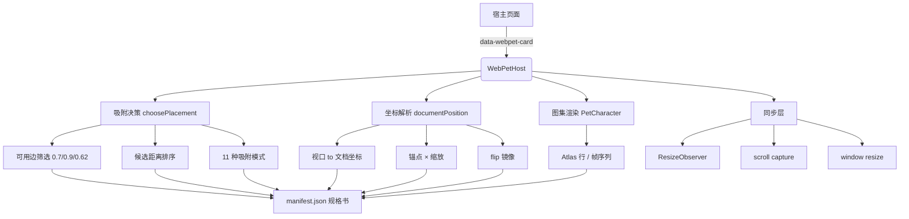

# WebPet · 可复用 2D 角色交互引擎

> 一个让 2D 角色「活」在真实网页里的引擎：它能站在卡片上、挂在下沿、探头偷看、
> 被拖走、自己巡逻，而且页面滚动 / 缩放 / 嵌套面板滑动时都不掉队。

**为什么不是「看板娘组件」**：Live2D / Spine 解决的是「角色动画播放」；
WebPet 解决的是「角色怎么活在一个真实网页布局里」——卡片在哪、能不能坐、
滚动了怎么办、被按钮挡住怎么点。**这是产品问题，不是动画问题。**

---

## 一、架构总览

```
┌──────────────────────────────────────────────────────────────┐
│                      宿主页面（任意 React App）                  │
│                                                                │
│   ┌──────────┐   ┌──────────┐   ┌──────────┐                  │
│   │  卡片 A   │   │  卡片 B   │   │  卡片 C   │  ← data-webpet-card
│   └──────────┘   └──────────┘   └──────────┘                  │
│         ▲              ▲              ▲                        │
└─────────┼──────────────┼──────────────┼──────────────────────┘
          │              │              │  几何查询（不持有引用）
          └──────────────┼──────────────┘
                         │
              ┌──────────▼───────────┐
              │      WebPetHost       │  ← 常驻挂载，createPortal(document.body)
              │  ┌────────────────┐   │
              │  │ position       │   │  文档坐标
              │  │ attachment     │   │  当前吸附（target + pose + layer）
              │  │ dragging       │   │
              │  │ patrolling     │   │
              │  └────────────────┘   │
              └──────────┬────────────┘
                         │
        ┌────────────────┼────────────────┐
        ▼                ▼                ▼
┌───────────────┐ ┌──────────────┐ ┌──────────────┐
│  吸附决策      │ │  坐标解析     │ │  图集渲染     │
│ choosePlacement│ │documentPosition│ │PetCharacter  │
│               │ │              │ │              │
│ ·可用边筛选    │ │ ·视口→文档    │ │ ·Atlas 行    │
│  (0.7/0.9/0.62)│ │ ·锚点×缩放   │ │ ·帧序列      │
│ ·候选距离排序  │ │ ·flip 镜像   │ │ ·帧间隔      │
│ ·11 种模式     │ │ ·offset 微调 │ │ ·mood 映射   │
└───────────────┘ └──────────────┘ └──────────────┘
        │                │                │
        └────────────────┼────────────────┘
                         ▼
              ┌────────────────────────┐
              │  同步层（useEffect）    │
              │  ResizeObserver(目标+滚动容器) │
              │  window scroll (capture)│
              │  window resize          │
              │  → 重算 documentPosition │
              └──────────┬─────────────┘
                         │
                         ▼
              ┌────────────────────────┐
              │   manifest.json 规格书  │
              │  atlas / animations     │
              │  poseAnchors / poseOffsets │
              │  edgeGap / hotZone / clickTolerance │
              └────────────────────────┘
```

### 数据流（一次拖拽落地）

```
pointerdown
   │
   ├─ 被覆盖元素是交互控件？ ──是──▶ clickThrough（等待抬起，短按则触发其 click）
   │
   └─ 否 ──▶ dragRef（记录起始点、时间戳）
                 │
                 ▼  pointermove
           targetAtPoint(x, y)         ← 热区判定 + elementsFromPoint 穿透
                 │
                 ▼
           choosePlacement(target)     ← 选边、选姿态、定翻转
                 │
                 ▼  pointerup
           documentPosition()          ← 锚点×缩放 + flip 镜像 + offset + scroll
                 │
                 ▼
           setPosition() ──▶ 渲染 + localStorage 持久化
```

---

## 二、目录结构

```text
webpet/
├── assets/webpet-template/          # 可复用的引擎本体（711 行 / 8 文件）
│   ├── public/webpet/
│   │   ├── pet.example.json         # 一份 manifest 示例
│   │   └── spritesheet.webp
│   └── src/webpet/
│       ├── types.ts                 # 类型：动画、姿态、吸附模式、Layer
│       ├── defaultWebPetConfig.ts   # 默认规格（含锚点、偏移、手感参数）
│       ├── PetCharacter.tsx         # 图集渲染：按行取帧、按间隔推进
│       ├── WebPet.tsx               # 核心：吸附决策、坐标、拖拽、巡逻（305 行）
│       ├── webpet.css
│       └── index.ts
│
├── playground/                      # 图集编辑器 + 校准工具（约 1,400 行）
│   ├── src/
│   │   ├── atlas.ts                 # 图集管线：切行、归一化、拼图、IndexedDB（239 行）
│   │   ├── AtlasInspector.tsx       # 锚点校准面板（122 行）
│   │   ├── imageProvider.ts         # 去背景 / 图像预处理
│   │   └── main.tsx                 # 编辑器主界面
│   └── webpet-project/              # 一个真实项目：manifest + 图集 + 拆帧
│       ├── manifest.json            # ← 规格书本体
│       ├── animation/spritesheet.webp
│       └── arrest/custom-1/frame-0x.webp
│
├── references/
│   ├── workflow.md                  # 集成与校准步骤
│   ├── source-map.md                # 与生产版（WYM Agent）的对照
│   └── wym-production-source/       # 生产版源码（仅作对照，不随模板分发）
└── SKILL.md                         # 给 AI 助手的使用说明
```

---

## 三、图集规格

| 项 | 值 |
|---|---|
| 单帧尺寸 | **192 × 208** |
| 排布 | **8 列 × 19 行**（最多 8 帧/行） |
| 总资源 | 1 张 WebP（约 1.9 MB） |
| 动画数 | **18 个**（每个占一行） |

### 18 个动画的分组

| 组 | 动画 | 用途 |
|---|---|---|
| **行为** | `idle` `runningRight` `runningLeft` `waving` `jumping` | 待机、巡逻、挥手、跳 |
| **状态** | `failed` `waiting` `working` `review` `catching` | 失败、等待、干活、检查、被拖起 |
| **吸附姿态** | `peekTop` `hangBottom` `sitTop` `peekSide` `hideSide` `grabSide` `cornerGrab` | 7 种「贴在卡片上」的姿势 |
| **扩展** | `custom-1` | 用户自定义行 |

> 注意：`hangBottom` / `peekSide` / `hideSide` / `grabSide` / `cornerGrab`
> 的 `frameInterval` 是 `999999` —— **单帧姿态，不播动画**。

### 姿态 → 渲染层映射

```ts
function poseLayer(pose) {
  return pose === 'peekTop' || pose === 'peekSide' || pose === 'hideSide'
    ? 'back'    // 探头类：画在卡片下面（只露出上半身）
    : 'front'   // 坐/挂/抓类：画在卡片上面
}
```

**这是语义映射，不是美术偏好**：探头要"从卡片后面探出来"，所以必须在卡片下层。

---

## 四、manifest.json：宠物规格书

**这是整套 workflow 的核心产物。换一个角色 = 改这份文件。**

```json
{
  "format": "webpet-project-manifest",
  "version": 1,
  "atlas": { "frameWidth": 192, "frameHeight": 208, "columns": 8, "rows": 19 },
  "settings": {
    "size": 148,
    "edgeGap": 16,
    "hotZone": 30,
    "clickTolerance": 8,
    "patrolDelayMs": 8000,
    "animations": { "idle": { "row": 0, "frames": 6, "frameInterval": 160 }, ... },
    "moodAnimations": { "idle": "idle", "thinking": "waiting", "success": "jumping" },
    "poseAnchors": { "peekTop": { "y": 193 }, "peekSide": { "x": 127 }, ... },
    "poseOffsets": { "peekTop": { "x": 0, "y": 0 }, "hangBottom": { "x": 0, "y": 25 }, ... }
  }
}
```

### 字段说明

| 字段 | 含义 | 怎么填 |
|---|---|---|
| `atlas.frameWidth/Height` | 单帧像素尺寸 | 画布定多大就填多大 |
| `atlas.columns` | 每行最多几帧 | 通常是 8 |
| `atlas.rows` | 总共几行 | 动画数 |
| `size` | 渲染尺寸（CSS px） | 148 = 宽 148px，高按比例 |
| `edgeGap` | 离屏幕边缘留白 | 16px |
| `hotZone` | 吸附热区半径 | 30px（越大越好拖） |
| `clickTolerance` | 点击/拖拽的判定阈值 | 8px（移动超过就算拖） |
| `patrolDelayMs` | 巡逻间隔 | 8000ms |
| `animations[row].frames` | 这一行有几帧 | 数图上有几个格 |
| `animations[row].frameInterval` | 帧间隔（ms） | 160ms ≈ 每秒 6 帧 |
| **`poseAnchors`** | **姿态的「接触点」像素坐标** | **用 AtlasInspector 校准** |
| **`poseOffsets`** | 视觉微调（不参与锚点计算） | 校准后微调 ±10px |

### 锚点 vs 偏移的区别

```
poseAnchors  → 角色身体哪一点贴着卡片边缘（数据，参与计算）
poseOffsets  → 为了让视觉对齐再加的位移（美术修正，不参与逻辑）
```

**锚点必须是数据**，否则换图集就要改代码；偏移只是视觉修正。

---

## 五、Workflow：从零到一个宠物

### 第 1 步：画图集

| 要求 | 说明 |
|---|---|
| 画布 | 每帧 **192 × 208** |
| 排布 | 横向排，一行一个动画 |
| 行数 | 至少 5 行（idle / runningRight / runningLeft + 2 个姿态） |
| 背景 | **透明**（WebP 或 PNG） |
| 导出 | 一张 WebP，尺寸 = `192×8` × `208×行数` |

**尺寸必须精确**，`splitSheetRows` 会校验：

```ts
if (image.naturalWidth !== expectedWidth || image.naturalHeight !== expectedHeight)
  throw new Error(`图集尺寸不匹配：需要 ${expectedWidth}×${expectedHeight}，实际 ...`)
```

### 第 2 步：填 manifest

按行号填 `animations`：

```json
"idle":         { "row": 0, "frames": 6, "frameInterval": 160 },
"runningRight": { "row": 1, "frames": 8, "frameInterval": 120 },
"sitTop":       { "row": 13, "frames": 5, "frameInterval": 160 }
```

**`row` 从 0 开始**，对应图集里第几行。

### 第 3 步：校准锚点（这是最容易卡住的一步）

用 `playground` 的 **AtlasInspector**：

1. 打开 playground，加载图集
2. 选中一个姿态（比如 `sitTop`）
3. **拖动画像，让它的「接触点」对准卡片边缘**
4. 面板实时显示当前 `x/y`，填回 `poseAnchors`
5. 数值对了但视觉还差一点 → 调 `poseOffsets`

**判断标准**：角色看起来像「真的站在卡片上」，而不是「浮在卡片上」。

### 第 4 步：导出并集成

```bash
# playground 导出 manifest + spritesheet
# 复制到目标项目
cp manifest.json  <你的项目>/public/webpet/
cp spritesheet.webp <你的项目>/public/webpet/
```

```tsx
import { WebPetHost } from './webpet'

// 挂在应用根部（一次）
<WebPetHost storageKey="my-pet" />

// 给需要吸附的元素标记
<div data-webpet-card data-webpet-attachment="top-bottom">...</div>
```

---

## 六、技术要点（面试可讲）

### ① 吸附决策：可用边筛选 + 候选排序

```ts
// 门槛按姿态的真实空间需求设定，不是统一值
if (rect.top >= size * 0.7)                    edges.push('top')     // 坐上边：露半身，0.7 够
if (innerHeight - rect.bottom >= size * 0.9)   edges.push('bottom')  // 挂下沿：露全身，要 0.9
if (innerWidth - rect.right >= size * 0.62)    edges.push('right')   // 侧边：只探个头，0.62
```

**为什么三个数不同？** 因为每个姿态占的空间不一样。**这是设计推理，不是调参。**

### ② 坐标转换：视口 → 文档

```ts
x: (edge === 'left' ? rect.left : rect.right) - renderedX * scale + offset.x + window.scrollX
```

**关键点**：
- `getBoundingClientRect()` 返回**视口坐标**，要加 `scrollX/Y` 才是文档坐标
- 容器用 `position: absolute`（不是 `fixed`）—— `fixed` 在嵌套滚动时会漂移
- `flip` 时锚点要镜像：`renderedX = flip ? frameWidth - sourceX : sourceX`

### ③ 同步：ResizeObserver + capture 滚动

```ts
observer.observe(attachment.target)
if (attachment.scrollContainer) observer.observe(attachment.scrollContainer)
window.addEventListener('scroll', sync, true)   // ← capture = true
```

**`capture: true` 是必须的** —— 否则嵌套面板内部滚动时，`scroll` 事件不会冒泡到 window。

### ④ 输入消歧：点击穿透

```ts
pointerdown → elementsFromPoint 找被覆盖的交互元素
移动距离 ≤ clickTolerance(8px) → 抬起时 target.click()
移动距离 > 8px                → 转成拖拽
```

**宠物盖住的按钮还能点** —— 这是很多人做挂件时忽略的体验细节。

### ⑤ 拖拽速度的指数平滑

```ts
drag.velocityX = drag.velocityX * 0.55 + 瞬时速度 * 0.45
```

**防抖动**：单帧瞬时速度噪声大，做惯性甩出必须平滑。

### ⑥ 巡逻（flyTo）：先定姿态 → 跑步过去 → 落地才吸附

**这是整个引擎里最容易做错的一段。** 关键点是**顺序**：不是「飞过去，到了再决定怎么贴」，
而是「先决定怎么贴，再跑过去」。

```ts
const flyTo = (target: HTMLElement) => {
  // ① 先选好吸附位姿（边缘 + 姿态 + 是否翻转）
  const placement = choosePlacement(target, config)
  const draft = { target, ...placement, layer: poseLayer(placement.pose),
                  scrollContainer: scrollContainerFor(target) }

  // ② 直接算出「吸附完成后」的最终坐标
  const origin = { x: originRect.left + scrollX, y: originRect.top + scrollY }
  const destination = documentPosition(draft, config)

  // ③ 清掉当前吸附状态
  clearAttachment()

  // ④ 按目标在左侧还是右侧决定朝向
  setPatrolFacing(destination.x < origin.x ? 'left' : 'right')

  // ⑤ 进入「巡逻中」——动画切到 runningLeft / runningRight
  setPatrolling(true)

  // ⑥ 两段弧线飞行
  const peak = Math.min(origin.y, destination.y)
             - Math.min(92, Math.max(34, Math.hypot(dx, dy) * 0.18))

  const tween = gsap.timeline({
    onComplete: () => {
      setPatrolling(false)
      attach(target, placement, { x: point.x, y: point.y }, duration)   // ← ⑦ 才吸附
    }
  })
  tween.to(point, { x: (origin.x + destination.x) / 2, y: peak,
                    duration: 0.34, ease: 'power2.out' })   // 起飞：先快后慢
       .to(point, { x: destination.x, y: destination.y,
                    duration: 0.34, ease: 'power2.in' })    // 降落：先慢后快
}
```

#### 每一环为什么这么设计

| 步骤 | 为什么不能省 |
|---|---|
| **先 `choosePlacement`** | 目的地取决于位姿（坐上边和挂下沿的目标点不同）。飞完再选会导致「先到错位置，再瞬移」 |
| **动画用 `runningLeft/Right`** | 巡逻是**跑**过去的，不是飞。`selectedAnimation` 的三元链里 `patrolling` 优先级在 `attachment.pose` 之前 |
| **`peak` 按距离动态算** | 固定高度会让近距离像「抽搐」、远距离像「贴地滑」。`clamp(距离×0.18, 34, 92)` 保证 34px 起、92px 封顶 |
| **`power2.out` + `power2.in`** | 起飞先快后慢（蹬地），降落先慢后快（重力加速）。**用同一个 ease 会显得很假** |
| **`onComplete` 里才 attach** | 飞行途中保持「自由 + 跑步」状态，落地那一刻才切换成吸附姿态 —— 这样姿态切换不突兀 |

#### 巡逻的触发条件

```ts
useEffect(() => {
  if (!patrol || attachment || dragging || mood !== 'idle') return   // ← 四个前置条件
  const schedule = () => {
    patrolTimer.current = setTimeout(() => {
      const candidates = [...document.querySelectorAll(CARD_SELECTOR)]
        .filter(t => t.isConnected && t.dataset.webpetIgnore !== 'true' && isVisible(t))
      if (candidates.length) flyTo(candidates[Math.floor(Math.random() * candidates.length)])
      schedule()   // ← 递归排下一次
    }, patrolIntervalMs ?? config.patrolDelayMs)
  }
  schedule()
  return () => { clearTimeout(patrolTimer.current); patrolTween.current?.kill() }
}, [...])
```

**四个前置条件缺一不可**：
- `patrol`：用户开了开关
- `!attachment`：已经贴着卡片时不再巡逻
- `!dragging`：正在被拖时不巡逻
- `mood === 'idle'`：**非待机心情不巡逻**（思考/干活/成功/失败时它"有事在忙"）

#### 候选卡片的筛选

```ts
t.isConnected                                  // 还在 DOM 里（防已卸载的节点）
t.dataset.webpetIgnore !== 'true'              // 显式排除（data-webpet-ignore="true"）
isVisible(t)                                   // 尺寸 > 24px、在视口内、非 display:none / opacity≈0
```

`isVisible` 的完整判定：

```ts
rect.width > 24 && rect.height > 24
  && rect.bottom > 0 && rect.top < window.innerHeight     // 与视口有交集
  && style.display !== 'none'
  && style.visibility !== 'hidden'
  && Number(style.opacity || 1) > 0.05
```

**注意 `opacity > 0.05` 而不是 `!== 0`** —— 渐隐动画途中的卡片也不算可见。

### ⑦ 回弹：`back.out(1.35)` 的落地弹跳

**吸附不是瞬间贴合，而是「冲过头再弹回来」。**

```ts
const attach = (target, placement, origin?, holdMs = duration) => {
  clearAttachment()
  const next = { target, ...placement, layer: poseLayer(placement.pose), ... }
  attachmentRef.current = next; setAttachment(next)

  const destination = renderPosition(next, config)

  // 有 origin（巡逻落地 / 拖拽释放）→ 播放回弹
  if (origin && !window.matchMedia('(prefers-reduced-motion: reduce)').matches) {
    const point = { x: origin.x, y: origin.y }
    setPosition(point)
    gsap.to(point, {
      x: destination.x, y: destination.y,
      duration: 0.48,
      ease: 'back.out(1.35)',          // ← 核心：先超过目标 35%，再回落到目标
      onUpdate: () => setPosition({ x: point.x, y: point.y })
    })
  } else {
    setPosition(destination)           // 直接挂载 or 用户开启了减弱动效
  }

  // 吸附有时限，到点自动脱落
  if (holdMs !== Number.POSITIVE_INFINITY)
    setTimeout(() => {
      if (attachmentRef.current?.target === target) clearAttachment()
    }, holdMs)
}
```

#### `back.out(1.35)` 到底是什么

```
back.out(1.35)：动画在接近终点时会「冲过」目标点（1.35 表示过冲强度），
然后反向弹回终点。

视觉上 = 宠物飞过来，「咚」地贴上卡片，身体往里一沉，再弹回正常位置。
```

**1.35 这个数的取舍**：

| 值 | 效果 |
|---|---|
| `< 1` | 几乎看不到回弹，像直接吸住 |
| `1.35` | 轻微过冲，像有弹性 |
| `> 2` | 过度摇晃，像果冻，不专业 |

**0.48 秒的时长**：太短（<0.3s）看不清，太长（>0.6s）会显得拖沓。

#### 三种进入吸附的路径

| 路径 | `origin` | 表现 |
|---|---|---|
| **巡逻落地** | 飞行终点坐标 | 跑步 → 弧线落地 → `back.out` 回弹贴上 |
| **拖拽释放** | 拖拽结束时 shell 的位置 | 松手 → `back.out` 回弹吸到最近边 |
| **直接挂载（首次）** | 无 | 直接就位，无回弹 |

#### 自动脱落

```ts
attachmentDurationMs = 15000
```

**贴着卡片 15 秒后会自己掉下来**，回到自由状态。

- 传 `Number.POSITIVE_INFINITY` 可以永久吸附
- 计时器里校验 `attachmentRef.current?.target === target` —— **防止「已经换到别的卡片了，旧计时器还在跑」**

### ⑧ 完整的状态机

宠物在任意时刻处于四种状态之一：

```
         ┌──────────────────────────────────────────┐
         │                                          │
    ┌────▼─────┐  受吸附/超时   ┌──────────────┐    │
    │   free   │◀──────────────│   attached   │    │
    │  (自由)  │               │   (已吸附)   │    │
    └────┬─────┘               └──────▲───────┘    │
         │                            │            │
   pointerdown                      落地/松手       │
         │                            │            │
    ┌────▼─────┐                      │            │
    │ dragging │──────────────────────┘            │
    │ (拖拽中) │  松手时 choosePlacement → attach   │
    └──────────┘                                   │
         │                                         │
    patrol 触发                                    │
         │                                         │
    ┌────▼──────┐  两段弧线飞行完成                 │
    │ patrolling│──────────────────────────────────┘
    │ (巡逻中)  │
    └───────────┘
```

**对应动画**（`selectedAnimation` 的三元链）：

```ts
dragging    ? 'catching'                                    // 拖拽中：被抓起来
: patrolling ? (patrolFacing === 'left' ? 'runningLeft' : 'runningRight')  // 巡逻中：跑
: attachment?.pose ?? animation ?? config.moodAnimations[mood]             // 其余：姿态/心情
```

**优先级：拖拽 > 巡逻 > 吸附姿态 > 显式 animation > 心情**。

### ⑨ 无障碍降级

```ts
if (window.matchMedia('(prefers-reduced-motion: reduce)').matches) {
  setPosition(destination)   // 直接吸附，不播飞行
}
```

### ⑩ 图集管线（Editor 一侧）

| 能力 | 实现 |
|---|---|
| 切行 | `splitSheetRows`（Canvas drawImage + 尺寸校验） |
| 归一化用户上传的帧条 | `normalizeRowImage`（**自动推算帧数**，容差 0.04） |
| 替换单帧 | `replaceRowFrame`（clearRect + drawImage） |
| 拼回整张图集 | `composeSpriteSheet` |
| 持久化 | **IndexedDB 存 Blob**（图集太大，localStorage 放不下） |
| 导出 WebP | `canvas.toBlob(type, 0.96)` |
| 内存管理 | `URL.createObjectURL` + `revokeObjectURL` |

**IndexedDB 存 Blob 这条值得讲** —— 很多人第一反应会用 localStorage，但 1.9MB 的 WebP 转 base64 会爆配额。

---

## 七、已知限制

| 限制 | 影响 | 如果能改 |
|---|---|---|
| **生图 / 图集自动生成未完成** | 需要自己画图集 | 接图像生成 API，按 manifest 规格产出 |
| 只支持**横排单行**图集 | 不能导入竖排或散图 | 加一个布局解析器 |
| 姿态是**固定 7 种** | 加新姿态要改 `POSES` 和类型 | 改成 manifest 驱动 |
| 无**多角色**支持 | 一个页面只能挂一个 | 容器改成数组 |
| 校准需要手动拖 | 换图集要重调锚点 | 做自动接触点检测（找 alpha 边界） |

---

## 八、下一步（如果要开源）

```
① 砍掉生图入口，或改成「请自备图集」        （30 分钟）
② 用一张现成精灵图做示例                     （30 分钟）
③ README = 本文档 + 一张 GIF                 （1 小时）
④ 已知问题如实列出                           （10 分钟）
```

**开源不需要功能完整，需要「能跑 + 说清 + 知道缺点」。**

---

## 附：Mermaid 版本架构图


