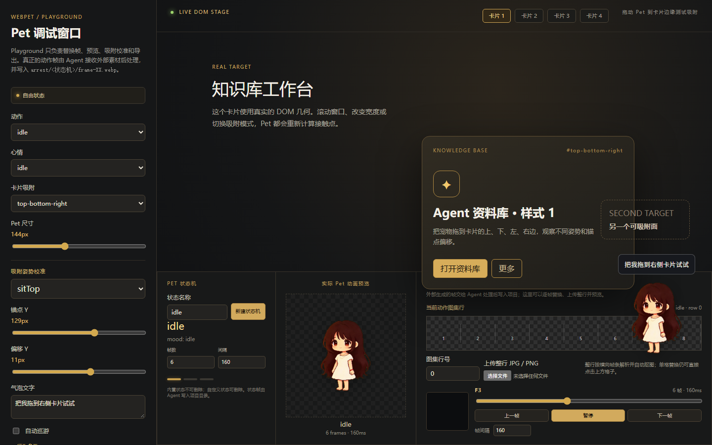

# WebPet

> **让 2D 角色吸附到任意 DOM 元素上。**

你的网页里有一堆卡片、面板、按钮。WebPet 让一个 Q 版角色住在里面——它能坐在卡片上沿、
挂在下边、从侧边探出半个身子、抓住角落，被拖走后又自己跑回去。



---

## 它解决什么问题

市面上有 Live2D、Spine 的网页播放器，也有各种桌面宠物。**但它们都不解决同一件事。**

| | Live2D / Spine | 桌面宠物 | **WebPet** |
|---|---|---|---|
| 播动画 | ✅ | ✅ | ✅ |
| 跨应用悬浮 | ❌ | ✅ | ❌ |
| **吸附到页面里的某个元素** | ❌ | ❌ | ✅ |
| **跟着元素滚动 / 缩放 / 重排** | ❌ | ❌ | ✅ |
| **挡住按钮后仍能点到** | ❌ | ❌ | ✅ |

**「这个动画该贴在哪个元素的哪条边上」是产品问题，不是动画问题。**

Live2D 只管画。WebPet 管的是：卡片在哪、能不能坐、滚动了怎么办、被按钮盖住怎么点。

---

## 快速开始

### 跑 demo

```bash
cd demo
npm install
npm run dev
```

打开 <http://localhost:5180>，你会看到 5 张演示卡片：

| 卡片 | `data-webpet-attachment` | 行为 |
|---|---|---|
| 任务卡片 | `top-bottom` | 能坐顶上，也能挂下沿 |
| 通知卡片 | `hang-bottom` | 只挂下沿 |
| 只坐顶部 | `sit-top-only` | 不允许挂下沿 |
| 抓角落 | `corner-grab` + `corner="bottom-auto"` | 自动选左右角并翻转 |
| 侧边探头 | `right-side-peek` | 只从右侧探出半个身子 |

顶栏可以切心情（待机/思考/干活/成功/失败）、开关自动巡逻、打开**坐标校准面板**。

### 跑 playground（图集编辑器）

```bash
cd playground
npm install
npm run dev
```

打开 <http://127.0.0.1:5987>。它能：

- 逐帧替换 / 整行替换
- 上传横向帧条自动切帧（调用本地 Python 抠图）
- **校准吸附锚点**（这是换角色时最麻烦的一步）
- 导出 manifest + spritesheet

> playground 需要 Pillow / NumPy / opencv-python。用 `WEBPET_PYTHON` 指定解释器。

---

## 目录结构

```
webpet/
├── packages/core/src/        # 引擎本体（711 行 / 6 文件，可整目录拷走）
│   ├── types.ts              # 类型：动画、姿态、吸附模式、Layer
│   ├── defaultWebPetConfig.ts# 默认规格 + mergeWebPetConfig
│   ├── PetCharacter.tsx      # 图集渲染：按行取帧、按间隔推进
│   ├── WebPet.tsx            # 核心：吸附决策、坐标、拖拽、巡逻、回弹
│   └── webpet.css
│
├── playground/               # 图集编辑器 + 锚点校准器
│   ├── src/atlas.ts          # 切行 / 归一化 / 拼图 / IndexedDB
│   ├── src/AtlasInspector.tsx# 锚点校准面板
│   ├── src/imageProvider.ts  # 本地抠图适配
│   └── server/sprite_processor.py
│
├── demo/                     # 最小可运行示例
│   ├── public/webpet/spritesheet.webp
│   ├── src/App.tsx
│   └── src/CalibrationPanel.tsx
│
└── ARCHITECTURE.md           # 深入原理：巡逻流程、回弹曲线、坐标转换
```

---

## 核心概念

### 1. 图集规格

| 项 | 值 |
|---|---|
| 单帧 | `192 × 208` |
| 排布 | `8 列 × 18 行`（每行一个动画，最多 8 帧） |
| 格式 | 一张 WebP，透明背景 |

### 2. `manifest.json` = 宠物规格书

**换一个角色 = 改这份文件，不用改代码。**

```json
{
  "atlas": { "frameWidth": 192, "frameHeight": 208, "columns": 8, "rows": 18 },
  "settings": {
    "size": 148,
    "animations": {
      "idle":         { "row": 0,  "frames": 1, "frameInterval": 999999 },
      "runningRight": { "row": 1,  "frames": 8, "frameInterval": 120 }
    },
    "poseAnchors": { "peekTop": { "y": 193 }, "peekSide": { "x": 127 } },
    "poseOffsets": { "peekTop": { "x": 0, "y": 0 } },
    "edgeGap": 16, "hotZone": 30, "clickTolerance": 8, "patrolDelayMs": 8000
  }
}
```

### 3. 锚点 vs 偏移

```
poseAnchors  → 角色身体哪一点贴着卡片边缘（数据，参与计算）
poseOffsets  → 为了视觉对齐再加的位移（美术修正，不参与逻辑）
```

**锚点必须是数据**，否则换图集就要改代码。

### 4. 七个吸附姿态

| 姿态 | 行 | 层 | 说明 |
|---|---|---|---|
| `peekTop` | 11 | back | 从卡片上沿探头，只有头和手 |
| `hangBottom` | 12 | front | 挂在下沿，双手抓边 |
| `sitTop` | 13 | front | 坐在上沿，腿垂下 |
| `peekSide` | 14 | back | 侧边探出半个身子 |
| `hideSide` | 15 | back | 侧边躲藏 |
| `grabSide` | 16 | front | 侧边抓握 |
| `cornerGrab` | 17 | front | 抓住角落 |

**back / front 决定 z-index**：`peekTop` 这类要在卡片**下面**（所以只露上半身），
`sitTop` 这类要在卡片**上面**（所以整条腿可见）。

---

## AI 素材工作流

**这套图集完全可以由 AI 生成。** 下面是实测跑通的流程。

### 第 1 步：做一张角色设定图

先单独生成一张**三视图 + 细节特写**的 reference sheet，作为后续所有生成的参考图。

要点：正面 / 侧面 / 背面三个视角都要有，另外加眼睛、发饰、服装的局部特写。

**这张图是后面所有一致性的来源。**

### 第 2 步：拆分「角色提示词」和「动作提示词」

**角色提示词（固定不变）**：

```
Use the character design from this reference sheet (front view).

Keep the EXACT character design:
- （发色 / 发型 / 头饰 / 耳朵 / 服装 / 尾巴 / 鞋袜，逐条列清楚）
- 3-head-tall chibi proportion

CRITICAL: keep the SAME round chubby proportion. Do NOT slim down.
           Do NOT make taller.
```

**动作提示词（每行变）**，放后面拼接。

### 第 3 步：关键技巧 —— 「看不见的边缘」

让角色画出「身体被某个平面挡住一部分」的效果时，**不要提到任何具体的墙/卡片**，
而是描述一个**不可见的平面**：

```
An INVISIBLE horizontal/vertical edge crosses her at [身体部位] level.
Everything beyond it is OCCLUDED by the invisible opaque plane — cut off cleanly
and NOT drawn.

The edge itself must NOT be drawn. No line, no bar, no wall, no shadow.
```

**三个关键词**：`invisible edge` / `occluded` / `NOT drawn`。

### 第 4 步：要「受力感」就描述解剖结果，不要描述物理

画「挂着」时，AI 默认画成放松站立的样子。要它画出用力抓握，得**描述看得见的东西**：

```
- Both arms are STRAIGHT and TENSE, stretched upward
- The SHOULDERS are pulled UP toward the ears
- The NECK is VISIBLY ELONGATED — about 20% longer than standing
- The HEAD is TILTED BACK, so the round underside of the chin is clearly visible
- Facial features sit slightly HIGHER on the face than usual
```

**「脖子被拉长」「肩膀耸起」「露出圆下巴」——全是视觉结果，不是原因。**

再加一句对比最有效：

```
Compared to her standing idle pose: neck +20% longer, shoulders higher,
head tilted back, chin exposed.
```

### 第 5 步：要「序列动画」就逐帧写死

**AI 不理解「帧序列」，只理解「8 张独立插画」。**

只写「8 帧眨眼循环」，它大概率给你 8 张睁眼 + 1 张闭眼。**必须逐帧指定**：

```
Generate exactly 8 frames in ONE horizontal row.

EYE STATES (frame by frame, left to right):
Frame 1: eyes fully open
Frame 2: eyes fully open
Frame 3: eyes about 70% open
Frame 4: eyes half closed, 40% open
Frame 5: eyes fully closed, a curved line
Frame 6: eyes half open
Frame 7: eyes about 80% open
Frame 8: eyes fully open

All other parts stay identical: same pose, same scale, same position.
Layout: 8 equal cells in one row, character occupies ~70% of each cell width,
        leave ~30% space between neighbours, characters must NOT touch.
```

### 第 6 步：后处理

生成图不能直接用，必须做四步：

| 步骤 | 做什么 | 为什么 |
|---|---|---|
| ① 等分切 | 按 `宽 / 8` 切格 | 间距波动会被格子吸收 |
| ② bbox 裁边 | 每格检测非白像素边界 | 去掉上下大片空白 |
| ③ 统一缩放 | 按 bbox **高度**缩放到 200px，水平居中 | 帧高一致比帧宽重要（脚底要齐） |
| ④ 白底抠透明 | 从**四角 floodfill** | 只抠外部背景，围裙的白色不会被误删 |

⚠️ **不要用简单阈值抠图** —— 会吃掉角色身上的白色区域（围裙、袜子）。必须用
「从边缘 floodfill，只抠连通到画面的白色」。

### 第 7 步：校准锚点

**这是换角色时唯一无法自动化的步骤。**

用 playground 的 AtlasInspector：

1. 加载图集和 manifest
2. 选中一个姿态
3. 拖动画面，让角色的「接触点」对齐到卡片边缘
4. 面板实时显示 `x / y`，填回 `poseAnchors`
5. 数值对了但视觉差一点 → 调 `poseOffsets`

**判断标准**：角色看起来像「真的贴在边沿上」，而不是「浮在旁边」。

### 常见坑

| 现象 | 原因 | 解法 |
|---|---|---|
| AI 画了全身、没有被挡 | prompt 里写了物理原因（"被重力拉下"） | 改成描述解剖结果 |
| 8 帧里只有 1 帧变化 | 只写了"循环"，没逐帧指定 | 逐帧写死每一帧的状态 |
| 角色变瘦 / 变高 | 没压住比例 | 加 `CRITICAL: keep the SAME proportion` |
| 帧之间贴在一起 | 没写间距约束 | 加「占格宽 70%，留 30% 空隙，不许接触」 |
| 抠图吃掉了围裙 | 用了全局白阈值 | 改成四角 floodfill |
| 侧边姿态左右反了 | 生成的图 nativeEdge 和代码假设相反 | 入图集前水平翻转 |

---

## API

```tsx
import { WebPetHost } from './webpet'

<WebPetHost
  config={manifestSettings}     // Partial<WebPetConfig>
  mood="idle"                   // idle | thinking | working | success | error
  animation="waving"            // 强制指定某个动画
  patrol                        // 自动巡逻
  bubble="把我拖到卡片上试试"      // 对话气泡
  storageKey="my-pet-v1"        // 位置持久化 key
  attachmentDurationMs={15000}  // 吸附多久后自行脱落（Infinity = 永久）
  onAttachmentChange={(a) => {}} // a.pose / a.edge / a.layer
/>
```

给页面元素加标记：

```html
<div data-webpet-card data-webpet-attachment="top-bottom">…</div>
<div data-webpet-card data-webpet-attachment="corner-grab" data-webpet-corner="bottom-auto">…</div>
<div data-webpet-ignore="true">不希望宠物靠近的元素</div>
```

---

## 一次拖拽发生了什么

```
pointerdown
   ├─ 被盖住的是按钮/链接？ → 记下，抬起时短距则触发它的 click
   └─ 否则开始拖拽
          ↓ pointermove
     targetAtPoint(x, y)      // 热区 + elementsFromPoint 穿透
          ↓
     choosePlacement(target)  // 选边、选姿态、定翻转
          ↓ pointerup
     documentPosition()       // 锚点 × 缩放 + flip 镜像 + offset + scroll
          ↓
     attach()                 // back.out(1.35) 回弹 + 15s 后自动脱落
```

巡逻则多一步：**先定好吸附位姿 → 算出落点 → 用 `runningLeft/Right` 跑过去 →
落地时才 attach**。详细说明见 [ARCHITECTURE.md](ARCHITECTURE.md)。

---

## 已知限制

| 限制 | 说明 |
|---|---|
| **一次只能挂一个实例** | 没有多角色支持 |
| **姿态固定 7 种** | 加新姿态要改 `types.ts` 的 `POSES` 和 manifest |
| **只支持横排图集** | 竖排或散图要先拼好 |
| **锚点需手动校准** | 换角色必须重调，无法自动推断 |
| **没有编辑器 UI**（除 playground） | 放置靠 `data-*` 属性 |
| **`bottom-auto` 按屏幕判断左右** | 不是按鼠标位置 |

---

## 相关文档

- [ARCHITECTURE.md](ARCHITECTURE.md) —— 巡逻流程、回弹曲线、坐标转换、状态机
- [demo/README.md](demo/README.md) —— demo 的具体配置说明

---

## License

MIT
